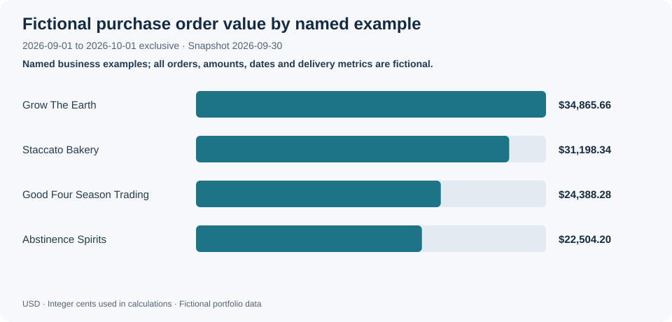

# Reusable reporting with AI assisted SQL

**A product case study and executable reporting project by Ziana Bennett.**

At SupplyBistro, I worked on planning an AI-assisted reporting initiative. A key clarification from my manager was to help the team create reusable canned reports internally. That direction changed the product question from how a customer might ask any question to how the team could define and validate useful reports in advance.

This repository develops that direction into an **independent AI-assisted portfolio extension**. The Python, SQL, documentation, and 72 fictional purchase orders were created for this exercise. They are not employer source code, company data, or evidence of a shipped SupplyBistro feature. The historical contribution is the planning context; the executable implementation is new portfolio work.

## My role and the original context

**SupplyBistro · Product planning · 2026**

I translated the reusable-reporting direction into scope, requirements, planning questions, and sprint dependencies. The central product tradeoff was how to make useful reporting repeatable while keeping the cost and build practical. I also presented the product direction to C-suite leadership and a prospective client, which required explaining the value and the choices behind the work.

The report definitions, executable code, and synthetic results in this repository are a new portfolio implementation of that planning problem. They make the reasoning inspectable without claiming that the exercise was deployed at SupplyBistro.

[Portfolio overview](https://zianabennett.github.io/#work) · [Experience and leadership](https://zianabennett.github.io/#experience)

## What the project delivers

Three reports answer concrete purchasing questions using a consistent set of business definitions. A small Python program loads the fictional data into an in-memory SQLite database and generates the JSON, readable tables, and charts below. It needs no external packages, account, or API key.

| Report | Default September result | Decision it supports |
| --- | --- | --- |
| Purchase order value by supplier | 42 orders totaling **$112,956.48** | Where is purchase order value concentrated? |
| Open overdue purchase orders | 9 orders totaling **$20,295.26** | Which outstanding orders need investigation? |
| On-time delivery | 24 of 31 receipts, or **77.42%** | How reliably did received orders meet their promised dates? |

These figures are calculated from the fictional model, using September 30, 2026 as the snapshot date. Purchase order value does not measure payments or revenue.



[Read the complete results](results/summary.md) or inspect the [machine-readable output](results/report_results.json).

## The product decisions

The central design choice is to separate report development from report execution. AI can assist with drafting a query, while an approved SQL definition supplies repeatable output. This implementation executes those definitions deterministically; it does not call an AI service at runtime.

The harder work is agreeing on what a report means. “Monthly value” follows booking date, while delivery performance follows receipt date. An order due today is not yet overdue. A delivery on its promised date counts as on time. Receipt and cancellation dates preserve the status that applied at the snapshot instead of applying later events to an earlier report.

Amounts are stored as integer cents. The overall delivery rate uses the combined order counts, and an empty denominator produces an unavailable rate rather than zero.

## Explore the work

| Material | Purpose |
| --- | --- |
| [Report requirements](docs/requirements.md) | Definitions and acceptance criteria |
| [Decisions and roadmap](docs/decisions-and-roadmap.md) | Tradeoffs, historical scope, and next implementation questions |
| [Method and data](docs/method.md) | Reproduction steps, event assumptions, and dataset design |
| [Data dictionary](data/data_dictionary.json) | Field meanings and constraints |
| [SQL definitions](sql/supplier_order_value.sql) | Start with the supplier report; the other reports are in the same folder |
| [Tests](tests/test_reporting.py) | Financial reconciliation and meaningful boundary cases |

## Run it locally

From this repository folder, with Python 3.9 or later installed:

```sh
python3 run.py
python3 -m unittest discover -s tests -v
```

On Windows, use `py` in place of `python3` if that is your Python launcher. Generated output is committed in `results/`, allowing the project to be read directly on GitHub without running it.

To compare another snapshot without replacing the published example:

```sh
python3 run.py --start 2026-09-01 --end 2026-10-01 --as-of 2026-10-03 --output-dir results_comparison
```

The end date is exclusive. The overdue report uses only the snapshot date and includes older open orders.

## Scope and next steps

The exercise models one currency and one completed receipt or cancellation per order. It excludes partial deliveries, returns, invoice payments, and production access controls. A real implementation would begin with the actual schema and an agreed report list, then validate against operational examples before integration. The project demonstrates requirements, analytical judgment, and reproducible reporting; it does not claim historical savings or production adoption.

