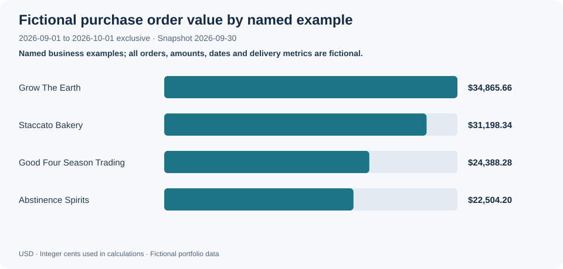
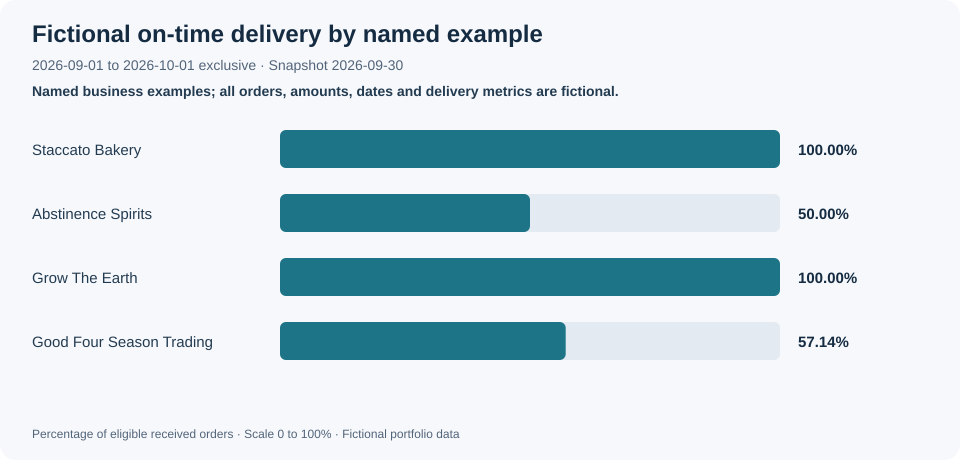

# Reporting results

[Project overview](../README.md) · [Machine-readable results](report_results.json)

Period **2026-09-01 to 2026-10-01**, with the end date excluded. Snapshot **2026-09-30**. The complete fixture contains **72 fictional orders**.

## Measures

| Measure | Computed result |
| --- | ---: |
| Qualifying purchase orders | 42 |
| Qualifying purchase order value | $112,956.48 |
| Open overdue orders at the snapshot | 9 |
| Value of open overdue orders | $20,295.26 |
| Received orders in the period | 31 |
| Received on time | 24 |
| On-time delivery rate | 77.42% |

The order-value measure uses booking date. The delivery measure uses receipt date. The overdue report uses the snapshot date and includes older open orders, regardless of the selected reporting month.

## Purchase order value by supplier

| Supplier | Orders | Order value |
| --- | ---: | ---: |
| Supplier Gamma | 12 | $34,865.66 |
| Supplier Alpha | 12 | $31,198.34 |
| Supplier Delta | 9 | $24,388.28 |
| Supplier Beta | 9 | $22,504.20 |

## Open overdue orders

| Order | Supplier | Promised date | Days overdue | Order value |
| --- | --- | --- | ---: | ---: |
| PO001 | Supplier Alpha | 2026-08-30 | 31 | $579.19 |
| PO031 | Supplier Gamma | 2026-09-05 | 25 | $2,954.89 |
| PO049 | Supplier Alpha | 2026-09-13 | 17 | $4,380.31 |
| PO019 | Supplier Gamma | 2026-09-14 | 16 | $2,004.61 |
| PO007 | Supplier Gamma | 2026-09-16 | 14 | $1,054.33 |
| PO071 | Supplier Gamma | 2026-09-20 | 10 | $2,400.00 |
| PO037 | Supplier Alpha | 2026-09-22 | 8 | $3,430.03 |
| PO010 | Supplier Beta | 2026-09-28 | 2 | $1,291.90 |
| PO066 | Supplier Beta | 2026-09-29 | 1 | $2,200.00 |

## On-time delivery

| Supplier | Received | On time | Rate |
| --- | ---: | ---: | ---: |
| Supplier Alpha | 9 | 9 | 100.00% |
| Supplier Beta | 8 | 4 | 50.00% |
| Supplier Gamma | 7 | 7 | 100.00% |
| Supplier Delta | 7 | 4 | 57.14% |

The overall rate is calculated from all eligible orders. It is not an average of supplier percentages. Suppliers with no receipts have no delivery rate and are omitted from that chart.

## Reading the output

These measures verify the behavior of a fictional reporting model. They are not company performance results. The ranked supplier values identify where a reviewer would start a purchasing discussion; the overdue list identifies orders to investigate. A business decision would also require operational context and validated real data.

Regenerate this folder with `python3 run.py`. Its JSON, tables, and charts are produced from the same report objects.
